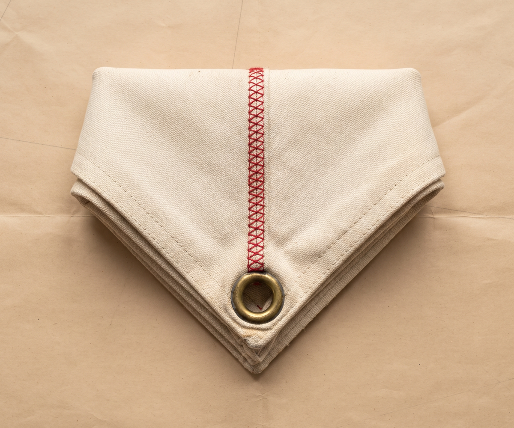

> Medium line first: watercolour on ivory, Baloo Paaji 2 in charcoal on a paper grey cabinet register plate, a tiny ivory oval glyph beside this heading and no other.

# chs-compliancepolicygenerator

# chs-CompliancePolicyGenerator
Generates platform-specific hardening scripts (for example shell scripts or Ansible playbooks) from a YAML configuration file, using a Jinja2 template for the chosen compliance standard and platform. The configuration must define a non-empty `policies` list. The template is read from `templates/<platform>/<standard>.j2` relative to the working directory, so the caller supplies the template tree for their own standards.

## Install

> Locket case inset: Install Jinja2 and PyYAML First. requirements.txt lists jinja2 and PyYAML, and the verified behaviour section below records why those two packages matter before a first run.
`git clone https://github.com/ShadowGuard-AI/chs-compliancepolicygenerator`

## Usage

> Locket case inset: Policies List Must Not Be Empty. The configuration must define a non empty policies list, and the template is read from the caller's own template tree.
`python3 main.py --compliance-standard CIS --config-file config.yaml --output-file hardening.sh --platform linux`

## Parameters
- `-h`: Show help message and exit
- `-c`, `--compliance-standard`: The compliance standard (for example CIS). Required.
- `-f`, `--config-file`: The path to the YAML configuration file. Required.
- `-o`, `--output-file`: The path to the output script file. Required.
- `-p`, `--platform`: The target platform (for example linux, windows). Required.

## Verified behavior

> Locket case inset: the configuration file is trusted input. Configuration values land in the output exactly as written and unsanitised, because the output is a script and the template decides where values go.
- The parameter list above is taken from the argument parser in `main.py`, and `main.py` passes `py_compile`.
- A live run was not completed in this wave: the `jinja2` package is not installed here and installs are not permitted in this wave, so `--help` and a generation run both stop at that missing import. Install `jinja2` and `PyYAML` from `requirements.txt` before running.
- A configuration without a non-empty `policies` list fails the run instead of producing an empty script.

## License
See LICENSE.
